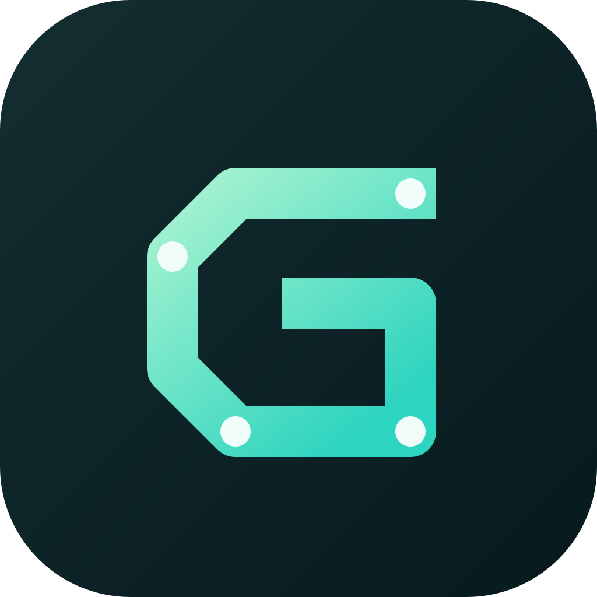

<div align="center">



# GMDA

**Your AI team. Your control.**

A local-first home for your AI agents. Give each bot its own personality, model,
workspace, and connected apps. Chat with your team, watch it work, and approve
what matters.

[Getting started](#development) · [Documentation](docs) · [Report an issue](https://github.com/arthurwang110505-debug/GMDA-bot/issues)

</div>

## What is GMDA?

GMDA stands for **Grok, Muse & Dots Alternative**. It is an independent product
built on the open-source core of [OpenMausBot](https://github.com/milind-soni/OpenMausBot).
GMDA is not affiliated with xAI, Meta, OpenAI, or the OpenMausBot maintainer.

- **Your agents:** work with supported local agent runtimes and model providers.
- **Your workspace:** keep conversations and configuration on your own computer.
- **Your decisions:** review approvals before sensitive actions happen.
- **Your connections:** use supported integrations and optional remote computers.

## Development

Requires **Node.js 24+** and **pnpm 10.33.0**. Install dependencies, then run the
server and renderer in separate terminals:

```sh
pnpm install --frozen-lockfile
pnpm dev:server
```

```sh
pnpm dev
```

Open the renderer URL printed by Vite. Provider setup and production deployment
instructions are available in the [upstream setup guide](README.upstream.md)
and [docs](docs). Those documents may still refer to OpenMausBot commands,
configuration paths, and upstream services.

```sh
pnpm typecheck
pnpm lint
pnpm i18n:check
pnpm exec vitest run src/lib/brand.test.ts server/brand.test.ts
```

Server and conversation verification must use the disposable fixtures described
in [the verification guide](docs/verification/README.md), not live user data.

## Branding

The shared product defaults are in [`shared/product-brand.ts`](shared/product-brand.ts).
The app name is **GMDA**, the tagline is **Your AI team. Your control.**, and the
mark uses a teal and mint palette. Existing theme palettes remain unchanged. The original geometric G mark lives in
[`public/app-icon.svg`](public/app-icon.svg).

Regenerate web and desktop icons after editing that SVG:

```sh
node scripts/generate-gmda-icons.mjs
```

See [the branding scope and release checklist](docs/gmda-branding.md) for
compatibility decisions and remaining release work. No GMDA mobile binaries or
hosted service are announced by this rebrand.

## Open-source attribution and licensing

The open-source core is provided under [Apache 2.0](LICENSE). Copyright and
third-party attribution remain in [NOTICE](NOTICE), [LICENSING.md](LICENSING.md),
and [`third_party/`](third_party/). See [README.upstream.md](README.upstream.md)
for the original project's README and acknowledgements.

**The `enterprise/` directory is not Apache-licensed.** It has a separate
[source-available license](enterprise/LICENSE) that restricts production use,
redistribution, hosting, and white-labelling. This branding work does not grant
those rights or bypass entitlement checks. Do not ship the enterprise directory
as part of GMDA without the required agreement; use the OSS-only build described
in [LICENSING.md](LICENSING.md).

MausBot Cloud, upstream mobile apps, and other upstream services remain their
providers' offerings, not GMDA services. Their names and endpoint URLs remain
explicitly upstream where integrations still reference them.
